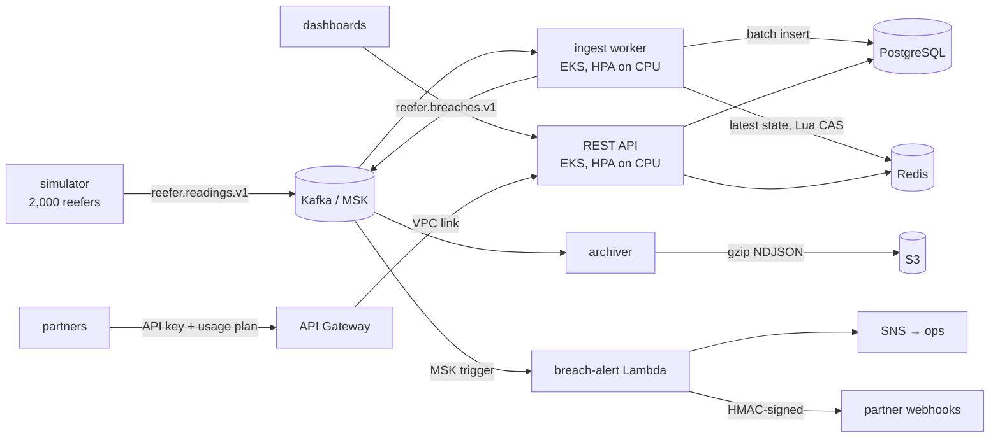

# Cold-Chain Container Monitoring Service

Developed with assistance from Claude Code.

Backend for tracking refrigerated shipping containers ("reefers"). It ingests
temperature telemetry through Kafka, stores history in PostgreSQL, keeps the
latest state of every unit in Redis, flags temperature breaches within
seconds, and serves everything over a REST API. Breach alerts are routed by
AWS Lambda to operators (SNS) and to partners (signed webhooks behind API
Gateway), and raw readings are archived to S3.



## Components

| Path | What it does |
| --- | --- |
| `cmd/api` | REST API: container registry, temperature history, live state, breaches, partner webhook subscriptions |
| `cmd/ingest` | Kafka consumer group: validates readings, batch-writes Postgres, updates Redis, detects breaches, publishes breach events |
| `cmd/archiver` | Separate consumer group copying raw readings to S3 (Hive-partitioned, gzip NDJSON) |
| `cmd/simulator` | Registers N simulated containers and streams realistic telemetry with injected faults |
| `lambda/breachalert` | MSK-triggered Lambda: SNS alert + webhook fan-out |
| `internal/domain` | Pure business rules: ISO 6346 IDs, breach state machine with hysteresis |
| `deploy/k8s` | Kustomize manifests (Deployments, HPAs, PDBs, migration Job, IRSA service accounts) |
| `deploy/terraform` | VPC, EKS on EC2, RDS + RDS Proxy, ElastiCache, MSK, S3, Lambda, SNS/SQS, API Gateway |

## REST API

| Method & path | Description |
| --- | --- |
| `POST /v1/containers` | Register a container (`id` must be a valid ISO 6346 number) |
| `GET /v1/containers?owner=&limit=&cursor=` | List containers (keyset pagination) |
| `GET /v1/containers/{id}` | Container details |
| `GET /v1/containers/{id}/readings?from=&to=&limit=&cursor=` | Temperature history from Postgres (indexed range scan, ≤ 31-day window) |
| `GET /v1/containers/{id}/state` | Latest reading and breach state from Redis, with `stale` flag |
| `GET /v1/containers/{id}/breaches` | Breach periods for one container |
| `GET /v1/breaches?open=true&since=` | Breaches across the fleet, newest first |
| `POST/GET/DELETE /v1/webhooks` | Partner webhook subscriptions (via API Gateway; requires `X-Partner-Id`) |
| `GET /healthz`, `GET /readyz` | Liveness / readiness (checks Postgres and Redis) |

Metrics are served on a separate port (`:9090/metrics`).

```bash
curl -s localhost:8080/v1/containers -d '{"id":"CSQU3054383","owner":"acme","commodity":"vaccines","setpoint_c":5,"min_temp_c":2,"max_temp_c":8}'
curl -s "localhost:8080/v1/containers/CSQU3054383/readings?from=2026-06-01T00:00:00Z&to=2026-06-02T00:00:00Z"
curl -s localhost:8080/v1/containers/CSQU3054383/state
```

## Design notes

**Breach detection in ~2 s.** Readings are keyed by container ID, so each
container lives on one partition and is evaluated in order by exactly one
consumer. The ingest worker polls with `FetchMaxWait` = batch wait (250 ms by
default) and processes batches of up to 500 readings; breach events are
published synchronously before offsets are committed. The metric
`coldchain_ingest_breach_detection_latency_seconds` measures device timestamp
→ event published, and the end-to-end test asserts p99 < 2 s for 2,000
containers.

**Hysteresis.** A breach opens when the temperature leaves `[min, max]` and
closes only once it is back inside by a margin (0.5 °C), so a reading
hovering on a limit does not produce an alert storm.

**At-least-once, made idempotent.** Offsets are committed after a batch is
fully processed. A replay is harmless because:
- `readings` has primary key `(container_id, recorded_at)` and inserts use
  `ON CONFLICT DO NOTHING`;
- breaches have a unique `(container_id, started_at)` and a partial unique
  index allowing one open breach per container;
- Redis state is written by a Lua compare-and-set on the reading timestamp,
  so late or redelivered messages never roll state backwards;
- detector state advances in memory only after all side effects succeed;
- webhooks carry a stable `X-Coldchain-Event-Id` for partner-side dedupe.

**Rebalances.** The consumer uses cooperative-sticky assignment and
`BlockRebalanceOnPoll`, so partitions never move mid-batch. Detector state for
revoked partitions is dropped and recovered from Redis by the next owner.

**Bad data never blocks a partition.** Undecodable, invalid or
unknown-container readings go to `reefer.readings.dlq.v1` with a
`reject-reason` header.

**Webhook security.** Partners are identified by their API Gateway API key
(injected as `X-Partner-Id`, not client-controlled), may only subscribe to
owners they hold a grant for, and receive HMAC-SHA256 signatures over
timestamp + body. Signing secrets are stored AES-256-GCM encrypted. Delivery
checks the resolved IP to block SSRF into the VPC and does not follow
redirects.

**Scaling.** API and ingest Deployments autoscale on CPU via HPA; ingest is
capped at the partition count (12) because extra consumers would idle, and it
scales slowly to limit rebalances. The EKS managed node group (Graviton EC2)
gives the cluster autoscaler room to add nodes.

## Running locally

Requires Go 1.26 and Docker.

```bash
make up        # Postgres, Redis, Kafka, S3 mock, Prometheus + all services
make logs      # follow ingest and api
```

The simulator registers 2,000 containers and streams one reading per
container every 5 s (400 msg/s). Try:

```bash
curl -s "localhost:8080/v1/breaches?open=true" | jq '.items | length'
```

Prometheus is on <http://localhost:9091>; p99 detection latency:

```
histogram_quantile(0.99, sum by (le) (rate(coldchain_ingest_breach_detection_latency_seconds_bucket[5m])))
```

## Testing

```bash
make test              # unit tests (race detector); no external deps
make test-integration  # real Postgres/Redis/Kafka via testcontainers (Docker)
make lint
```

CI (`.github/workflows/ci.yml`) runs lint, unit tests, the integration suite
against Kafka and Postgres containers, Terraform validation and image builds;
branch protection requires all of them before merging.

## Deploying to AWS

1. `cd deploy/terraform && terraform init -backend-config=... && terraform apply`
   (build the Lambda first with `make lambda`).
2. Install External Secrets Operator and the `aws-secrets-manager`
   ClusterSecretStore; replace `ACCOUNT_ID` in `deploy/k8s/serviceaccounts.yaml`.
3. Merge to `main`: `deploy.yml` builds arm64 images, pushes to ECR, runs the
   migration Job and rolls out to EKS.
4. Once the AWS Load Balancer Controller has created the internal NLB, set
   `api_nlb_arn` and `partners` and apply again to create the partner API
   Gateway, then insert `partner_grants` rows for each partner's API key id.

## Configuration

All services are configured through environment variables; see
`internal/config/config.go` for the full list and defaults. Highlights:

| Variable | Default | Used by |
| --- | --- | --- |
| `DATABASE_URL` | – (required) | api, ingest |
| `REDIS_ADDR` | `localhost:6379` | api, ingest |
| `KAFKA_BROKERS` / `KAFKA_TLS` | `localhost:9092` / `false` | ingest, archiver, simulator |
| `INGEST_BATCH_SIZE` / `INGEST_BATCH_WAIT` | `500` / `250ms` | ingest |
| `BREACH_HYSTERESIS_C` | `0.5` | ingest |
| `WEBHOOK_SECRET_KEY` | – (webhooks disabled if unset) | api, Lambda |
| `ARCHIVE_BUCKET` | – (required) | archiver |
| `SIM_CONTAINERS` / `SIM_INTERVAL` | `2000` / `5s` | simulator |
